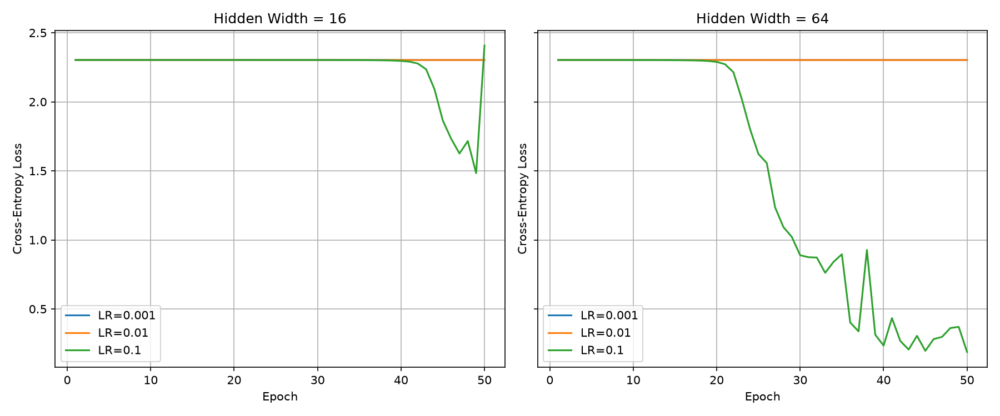

# Lab 2 - Neural Network from Scratch

## Project Description

This project implements a two-hidden-layer neural network from scratch using Python and NumPy. The goal is to recognize handwritten digits (0-9) using the `load_digits` dataset.

The project includes forward propagation, cross-entropy loss, backpropagation, numerical gradient checking, model training, and performance evaluation.

## Technologies Used

- Python
- NumPy
- Matplotlib
- Scikit-learn

## Results

| Metric | Result |
|---|---|
| Dataset | load_digits |
| Total Images | 1,797 |
| Training Images | 1,257 |
| Testing Images | 540 |
| Hidden Layers | 2 |
| Experiments | 6 |
| Training Epochs | 50 |
| Gradient Check | 10/10 PASS |
| Best Hidden Width | 64 |
| Best Learning Rate | 0.1 |
| Best Test Accuracy | 90.74% |
| Forward Median (64) | 0.081 ms |
| Backward Median (64) | 0.16585 ms |

## Training Results

The network was tested with two hidden layer widths (16 and 64) and three learning rates (0.001, 0.01, and 0.1).

The best configuration achieved 90.74% test accuracy.

### Loss Curves

## How to Run

1. Install Python.
2. Install the required packages: `pip install numpy matplotlib scikit-learn`
3. Run the program: `python main.py`

The generated graphs and performance results are saved in the `results` folder.