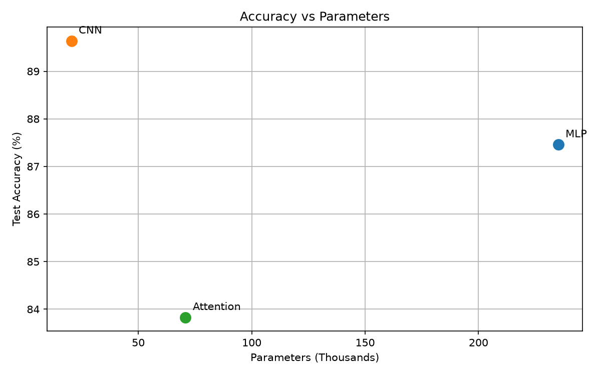
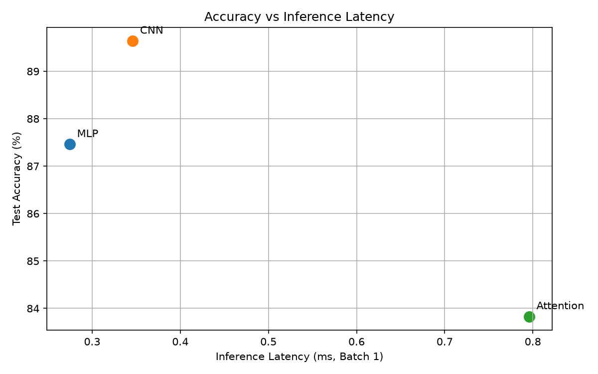

# Lab 3 - Architectures and Their Costs

## 1. Introduction

This laboratory compares three neural network architectures:
Multi-Layer Perceptron (MLP), Convolutional Neural Network (CNN),
and an Attention-based Transformer.

The aim is to compare accuracy, parameter count,
computational cost, inference latency, and memory-access patterns.

## 2. Dataset and Training

- Dataset: Fashion-MNIST
- Training images: 55,000
- Validation images: 5,000
- Test images: 10,000
- Image size: 28 x 28
- Batch size: 128
- Optimizer: Adam
- Learning rate: 0.001
- Training epochs: 5

## 3. Model Architectures

### MLP

Flatten(784) -> Linear(256) -> ReLU ->
Linear(128) -> ReLU -> Linear(10)

### CNN

Conv2d(1,16,3,padding=1) -> ReLU -> MaxPool2d(2) ->
Conv2d(16,32,3,padding=1) -> ReLU -> MaxPool2d(2) ->
Flatten -> Linear(1568,10)

### Attention

16 image patches of 7x7 pixels ->
Linear projection to 64 dimensions ->
Two Transformer Encoder layers ->
Mean pooling -> Linear(64,10)

Each Transformer Encoder has 4 attention heads
and a feedforward dimension of 128.

## 4. Experimental Results

| Model | Parameters | Test Accuracy | Batch 1 (ms) | Batch 128 (ms) |
|---|---:|---:|---:|---:|
| MLP | 235,146 | 87.46% | 0.2746 | 1.0375 |
| CNN | 20,490 | 89.64% | 0.3461 | 27.7859 |
| Attention | 70,794 | 83.83% | 0.7959 | 7.5688 |

The latency values are CPU measurements, recorded
as the median over 100 runs for batch 1
and 20 runs for batch 128.

## 5. FLOPs Comparison

| Model | Hand-calculated FLOPs | THOP-estimated FLOPs |
|---|---:|---:|
| MLP | 469,504 | 469,504 |
| CNN | 2,063,488 | 2,063,488 |
| Attention | 2,329,856 | 1,182,976 |

All FLOPs values are per single image.

The hand calculations use the approximation
that one multiply-accumulate operation equals two FLOPs.

### Hand Calculation Formulas

MLP:

2 x (784 x 256 + 256 x 128 + 128 x 10)

CNN:

2 x (28 x 28 x 16 x 1 x 3 x 3
+ 14 x 14 x 32 x 16 x 3 x 3
+ 32 x 7 x 7 x 10)

Attention:

Patch projection, QKV projections, attention scores,
attention-weighted values, output projections,
and feedforward layers are included.

The hand calculations omit some operations such as
bias additions, activation functions, normalization,
pooling, and softmax.

THOP estimates are obtained by multiplying its
reported MAC count by two. THOP may not count
all functional operations, especially inside
Transformer attention.

Therefore, the difference between hand calculations
and THOP estimates does not necessarily indicate
an error in the architecture.

## 6. Architectural Trade-Offs

### Accuracy vs Parameters

### Accuracy vs Latency

## 7. Discussion

### MLP

MLP achieved 87.46% accuracy
with 235,146 parameters.

It has simple dense layers and regular matrix operations.
However, flattening the image removes explicit
two-dimensional spatial structure.

Dense layers also require reading many independent
weight values from memory.

### CNN

CNN achieved 89.64% accuracy
with 20,490 parameters.

Convolution uses shared filters to learn local patterns.
This reduces the number of parameters and provides
useful weight reuse.

CNN must also access intermediate feature maps,
so low parameter count does not automatically mean
the lowest computational cost or latency.

### Attention

Attention achieved 83.83% accuracy
with 70,794 parameters.

Self-attention allows image patches to exchange information.
However, QKV projections, attention matrices,
and feedforward layers introduce computational
and memory-access overhead.

This model does not include explicit positional embeddings,
which may limit its ability to represent spatial positions.

## 8. Conclusion

CNN obtained the highest accuracy and used the fewest
parameters in this experiment.

MLP had the lowest batch-1 inference latency.

Attention was slower and less accurate under the tested
five-epoch training configuration.

There is no universally best architecture:
the preferred model depends on accuracy, memory,
computation, latency, and application requirements.

The laboratory manual mentions a target of approximately
100,000-150,000 parameters, while the specified layer
configurations produce different parameter counts.
The prescribed layer configurations were retained.

## 9. Implementation

- main.py: dataset, architectures, profiling, and training
- task5.py: trade-off plots and comparison table
- task6.py: final report generation
- results/: figures, timing, FLOPs, and training results
